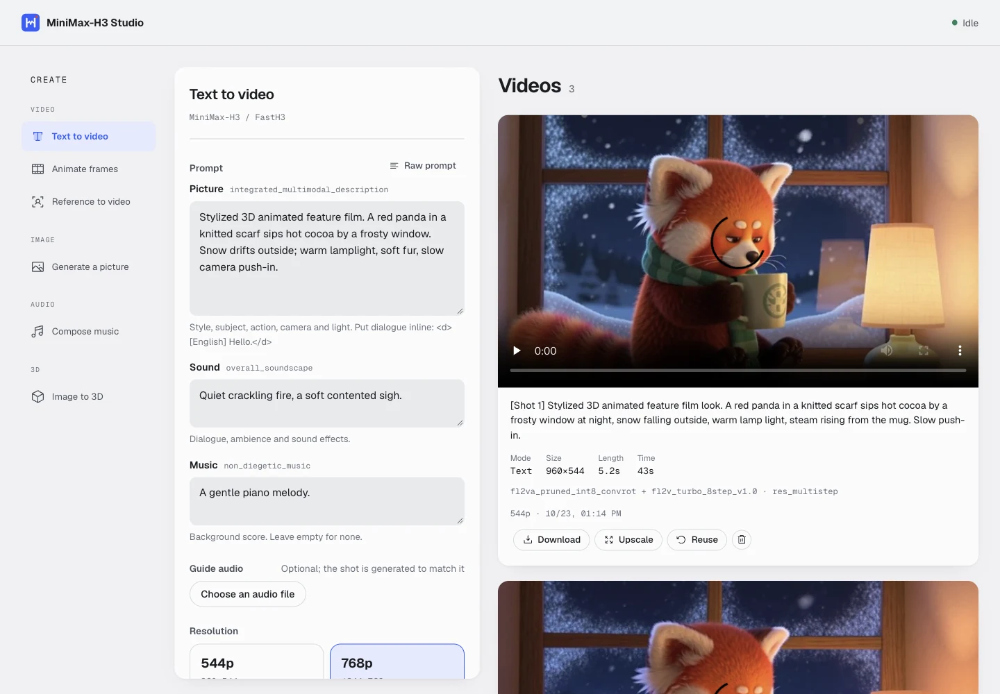
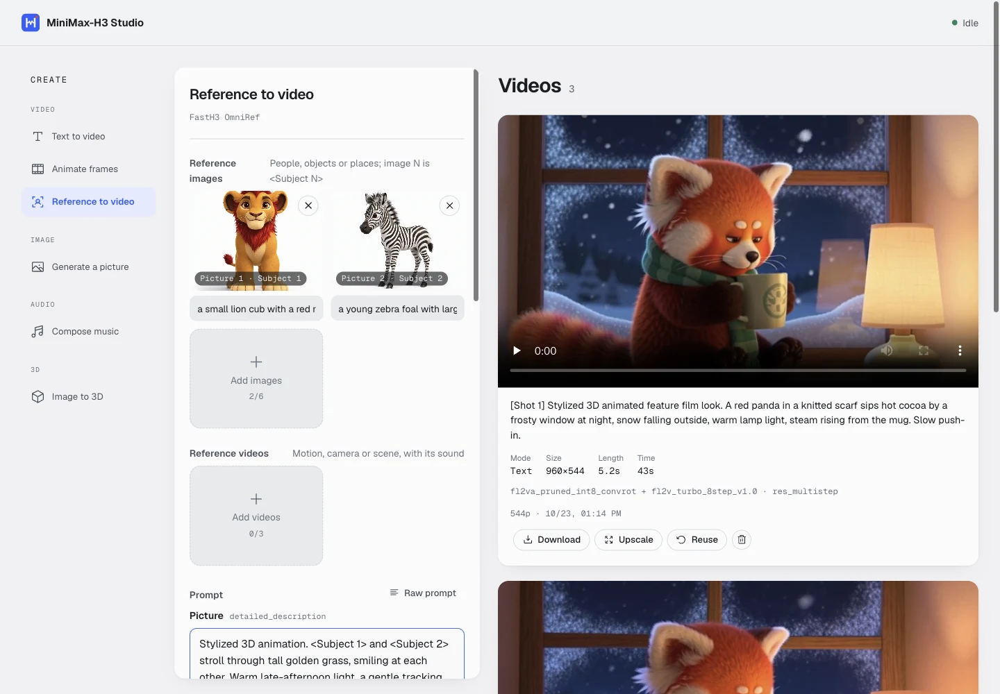
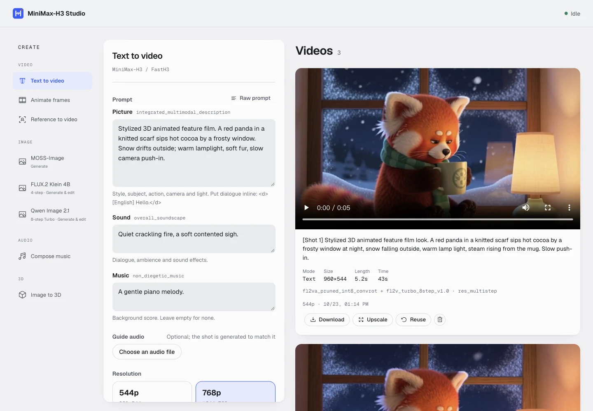
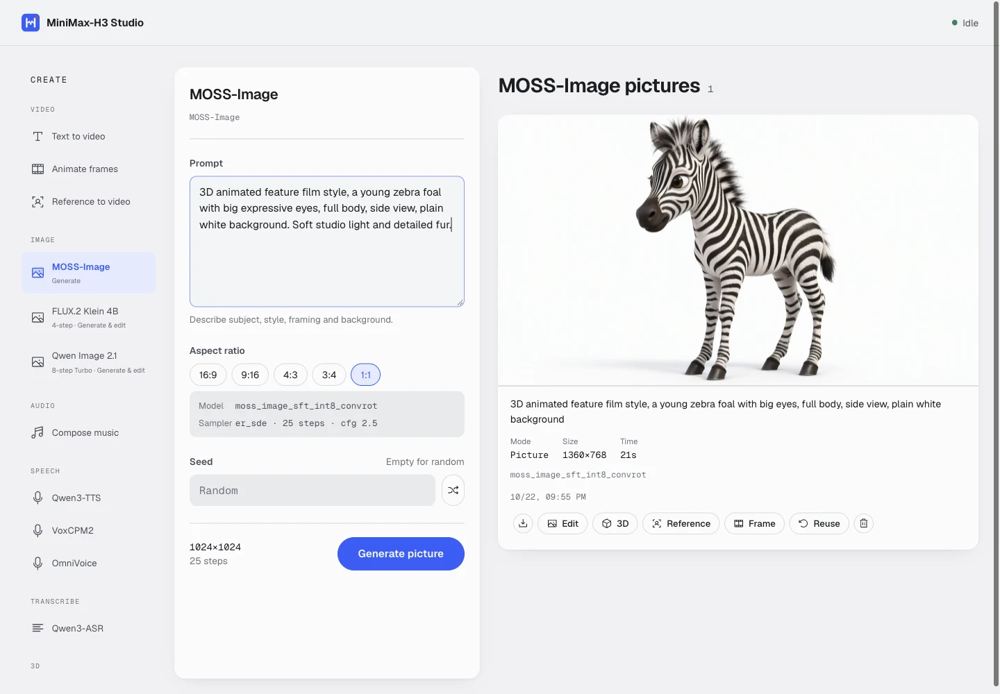
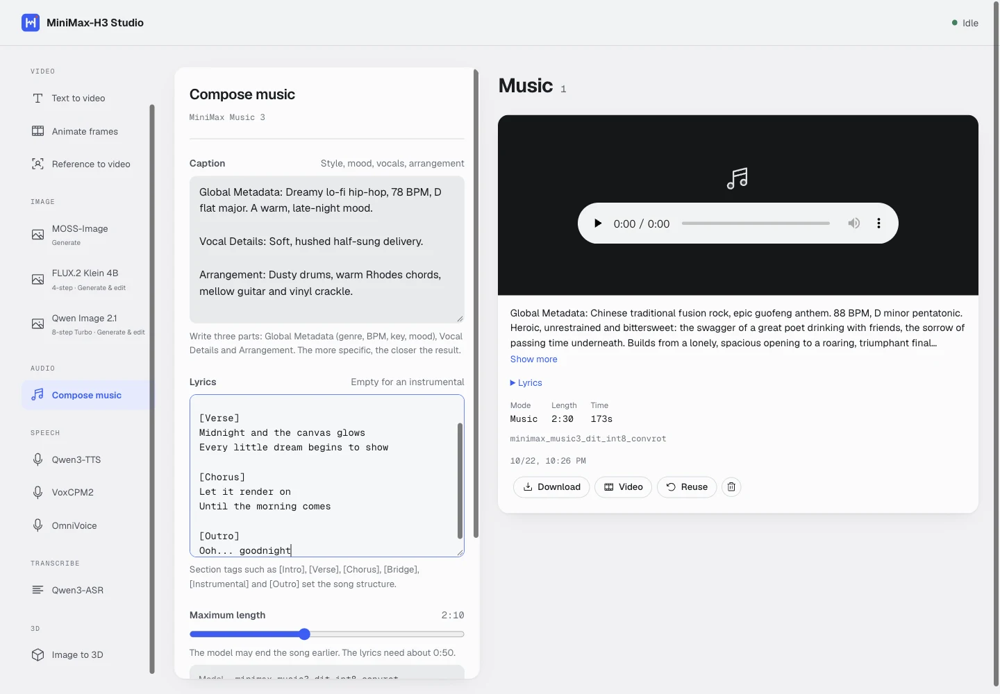
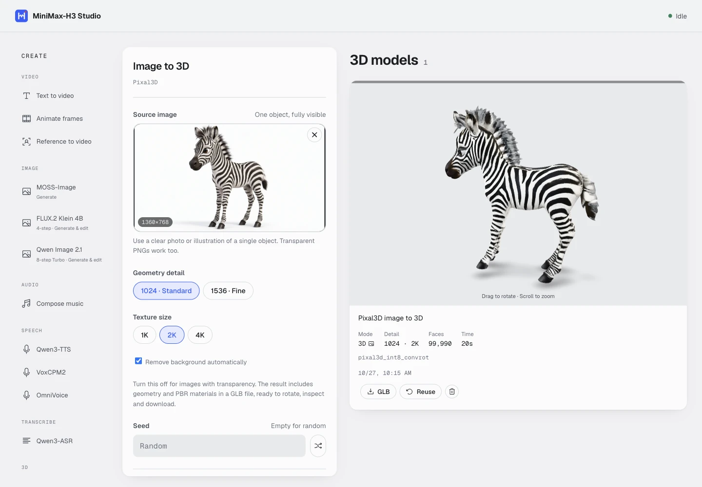

# MiniMax-H3 Studio

A self-hosted web studio for [MiniMax-H3](https://huggingface.co/Comfy-Org/MiniMax-H3) audio-video generation on a single GPU machine. It drives ComfyUI as a Python library (no ComfyUI UI, no workflow JSON) so it can use the quantized ComfyUI checkpoints and ComfyUI's dynamic VRAM offloading, and puts a resident job server and a browser UI in front of it.

- **Text to video**, **image to video** (first frame, or first + last frame) and **references to video** (up to 6 images and 3 videos; a reference video passes on its motion, camera, scene and sound).
- Turbo LoRAs (4 / 8 steps) from [lightx2v](https://huggingface.co/lightx2v/Minimax-h3-Turbo) and [larryvrh](https://huggingface.co/larryvrh/MiniMax-H3-Turbo-Lora), selectable per job; the base model follows the mode automatically.
- **Picture generation** with [MOSS-Image](https://huggingface.co/Comfy-Org/MOSS-Image), for making reference images and first frames; a finished picture goes into a video job with one click.
- **Image to 3D** with [Pixal3D](https://huggingface.co/Comfy-Org/Pixal3D): a single image becomes a textured GLB, with interactive rotation/zoom and download.
- **Music generation** with [MiniMax Music 3](https://huggingface.co/Comfy-Org/MiniMax-Music-3): songs up to 5 minutes from a caption and lyrics.
- **Upscaling** finished videos to 1080p or 1440p with [FlashVSR v1.1](https://huggingface.co/JunhaoZhuang/FlashVSR-v1.1) (fast) or [SeedVR2](https://huggingface.co/Comfy-Org/SeedVR2), keeping their sound.
- **Guide audio** for video jobs: anchor a slice of a song or recording as the shot's soundtrack, so singing, speech and motion follow it (music videos, lip sync).
- FastVideo's distilled [FastH3](https://huggingface.co/FastVideo/FastVideo-FastH3-Comfy) 8-step checkpoints as a second model group that runs without a LoRA.
- Weights stay loaded between jobs; jobs run one at a time from a persistent queue.
- H3 video output is pixel-identical to the official ComfyUI example workflows with the same settings.
- One script deploys the server and UI to a GPU machine over SSH; another downloads every checkpoint.

On an RTX 4090 a 5-second clip with sound takes about 30–45 s at 544p and 65–70 s at 768p.



## Requirements

**GPU machine** (where generation runs)

- Linux with an NVIDIA GPU. Developed on an RTX 4090 24 GB with 125 GB RAM; checkpoints are memory-mapped, so plenty of system RAM (64 GB+) and a fast SSD help.
- A [ComfyUI](https://github.com/comfyanonymous/ComfyUI) checkout with MiniMax-H3 support (developed against v0.42) and its Python environment (conda or venv). **You install ComfyUI yourself**; this project only imports it.
- systemd, and `sudo` without a password prompt for the deploy user (the deploy script installs and restarts a systemd unit over non-interactive SSH).
- `python3`, `curl` and `rsync`.
- Optional, about 2× faster: `triton` and `sageattention` in the ComfyUI environment (enabled through `H3_COMFY_ARGS`).
- Optional, for the larryvrh LoRA: its ComfyUI node, `git clone https://github.com/larryvrh/ComfyUI-MiniMax-H3-Turbo <ComfyUI>/custom_nodes/ComfyUI-MiniMax-H3-Turbo`.
- Optional, for FlashVSR upscaling: T8star's FlashVSR+ node, `git clone https://github.com/T8mars/Comfyui-Flashvsr-Plus-T8 <ComfyUI>/custom_nodes/Comfyui-Flashvsr-Plus-T8` (developed against commit `ac60d1e`; its requirements are already in a ComfyUI environment).

**Your machine** (where you deploy from): Node.js 18+, `ssh` with key-based login to the GPU machine, `rsync`, and `scp`.

### comfy_kitchen on PyTorch older than cu130

ComfyUI runs the int8 checkpoints' matmuls and FastH3's attention through [comfy_kitchen](https://pypi.org/project/comfy-kitchen/), which has `cuda`, `triton` and `eager` (plain PyTorch) backends. Two things keep the fast backends off on a cu128 setup like the reference machine (torch 2.11.0+cu128, driver 570):

1. The published comfy_kitchen CUDA wheels need the CUDA 13 runtime and an NVIDIA driver r580 or newer, so their CUDA ops do not load on a cu128 setup with driver 570. Rebuild it from source against the CUDA toolkit that matches your torch (source builds support CUDA 12.8 and newer), for your GPU's architecture, and install that wheel into the ComfyUI environment. This is how the reference machine's comfy_kitchen 0.2.39 was built:

   - Prerequisites: the CUDA toolkit matching torch's CUDA (`python -c "import torch; print(torch.version.cuda)"`; here `/usr/local/cuda-12.8` with `nvcc`), CMake 3.26+ and nanobind 2+ (pip fetches both into the build environment), and your GPU's compute capability without the dot (`nvidia-smi --query-gpu=compute_cap --format=csv`: `8.9` → `89` for RTX 40, `86` for RTX 30, `120` for RTX 50). Building only for your own architecture is much faster than the default list.
   - Get the source from [Comfy-Org/comfy-kitchen](https://github.com/Comfy-Org/comfy-kitchen) at the tag of the version ComfyUI installed (`pip show comfy-kitchen`). It vendors CUTLASS and flash-attention as git submodules, so clone recursively:

     ```bash
     git clone --branch v0.2.39 --recurse-submodules https://github.com/Comfy-Org/comfy-kitchen ~/build/comfy-kitchen-0.2.39
     ```

     Keep a copy of the installed package first so you can roll back: `cp -r <site-packages>/comfy_kitchen ~/build/backup_kitchen_cu13`.
   - Build a wheel inside the ComfyUI environment (about a few minutes; build dependencies such as cmake, ninja and nanobind are fetched by pip):

     ```bash
     conda activate comfyui            # or the ComfyUI venv
     cd ~/build/comfy-kitchen-0.2.39
     export CUDA_HOME=/usr/local/cuda-12.8 PATH=/usr/local/cuda-12.8/bin:$PATH
     export COMFY_CUDA_ARCHS=89        # your compute capability; setup.py reads it (its README's
                                       # equivalent is `python setup.py build_ext --cuda-archs="89" bdist_wheel`)
     export MAX_JOBS=16 CMAKE_BUILD_PARALLEL_LEVEL=16
     pip wheel . --no-deps -w ~/build/dist -v 2>&1 | tee ~/build/build.log
     ```

   - Install it over the published wheel and check that the CUDA backend loads:

     ```bash
     pip install --force-reinstall --no-deps ~/build/dist/comfy_kitchen-0.2.39-*.whl
     python -c "import comfy_kitchen as ck; print(ck.list_backends()['cuda']['available'])"   # True
     ```

   If `available` stays `False`, read `unavailable_reason` in `ck.list_backends()['cuda']`; it is usually a toolkit / driver mismatch or a wrong `COMFY_CUDA_ARCHS`. Updating ComfyUI can pull a newer published comfy_kitchen back in; rebuild the new version the same way.
2. Even then, stock ComfyUI disables the CUDA backend whenever torch is older than cu130, in `comfy/quant_ops.py`:

   ```python
   if cuda_version < (13,):
       ck.registry.disable("cuda")
       logging.warning("WARNING: You need pytorch with cu130 or higher ...")
   ```

   Patch it so the backend is only disabled when its ops really fail to load:

   ```diff
   -        if cuda_version < (13,):
   +        # Local change: comfy_kitchen is built from source for this CUDA version, so keep its CUDA backend
   +        # below cu130 as long as its ops load; only disable it when they do not.
   +        if cuda_version < (13,) and not ck.list_backends().get("cuda", {}).get("available"):
                ck.registry.disable("cuda")
   ```

   The same change as a command, safe to run more than once (it backs up the original to `quant_ops.py.orig`):

   ```bash
   cd /path/to/ComfyUI && python3 - <<'EOF'
   from pathlib import Path
   p = Path("comfy/quant_ops.py"); t = p.read_text()
   old = "        if cuda_version < (13,):\n            ck.registry.disable(\"cuda\")"
   new = ("        if cuda_version < (13,) and not ck.list_backends().get(\"cuda\", {}).get(\"available\"):\n"
          "            ck.registry.disable(\"cuda\")")
   if new in t:
       print("already patched")
   elif old in t:
       Path("comfy/quant_ops.py.orig").write_text(t)
       p.write_text(t.replace(old, new)); print("patched")
   else:
       raise SystemExit("pattern not found: ComfyUI changed this code, apply the idea by hand")
   EOF
   ```

Keep `--enable-triton-backend` in `H3_COMFY_ARGS` too. Restart the server afterwards and check its startup log (`journalctl -u h3-server`) for `Found comfy_kitchen backend cuda: {'available': True, 'disabled': False, ...}`. On the 4090 this made every model 17–48% faster (the timings in this README). The patch lives in the ComfyUI checkout, not in this repo: re-apply it after updating ComfyUI (a `git pull` may also conflict with it). If the CUDA backend is unavailable, everything still runs on triton, only slower.

## Quick start

```bash
git clone https://github.com/<you>/minimax-h3-studio && cd minimax-h3-studio
cp .env.example .env          # then edit it, see Configuration
./deploy.sh models            # download configured checkpoints into ComfyUI/models on the GPU machine
./deploy.sh                   # build the UI, install the server, start it
```

Open `http://<gpu-host>:8190`. The first start loads the text encoder and VAEs; the UI shows when the server is ready.

## Configuration

Everything machine-specific lives in `.env` (git-ignored; never commit it). `.env.example` documents each value. Variables already set in your shell take precedence over `.env`.

| Variable | Required | Default | Meaning |
|---|---|---|---|
| `H3_DEPLOY_HOST` | yes | | SSH target of the GPU machine, e.g. `me@gpu-host` |
| `H3_COMFYUI` | yes | | ComfyUI checkout on the GPU machine |
| `H3_CONDA_ENV` | | `comfyui` | Conda env that runs ComfyUI |
| `H3_CONDA_SH` | | `~/miniconda3/etc/profile.d/conda.sh` | conda init script to source |
| `H3_PYTHON` | | | Absolute path of a Python interpreter (venv); overrides the conda settings |
| `H3_DEPLOY_DIR` | | `~/minimax-h3-studio` | Install directory on the GPU machine (code, UI and `data/`) |
| `H3_SERVICE_USER` | | SSH user | User the service runs as |
| `H3_SERVICE` | | `h3-server` | systemd unit name |
| `H3_HOST` / `H3_PORT` | | `0.0.0.0` / `8190` | Address the server listens on |
| `H3_COMFY_ARGS` | | `--enable-triton-backend --use-sage-attention` | Extra ComfyUI CLI flags; set it empty if triton / sageattention are not installed |
| `HF_ENDPOINT` | | `https://huggingface.co` | Hugging Face mirror for model downloads |
| `HF_TOKEN` | | | Token for gated or private repos |
| `H3_API` | | `http://<deploy host>:<port>` | Where `npm run dev` proxies API calls |

## Models

`./deploy.sh models` runs `scripts/prepare_models.py` on the GPU machine. It downloads exactly what the server is configured to use (the list comes from `server/model_catalog.py`), skips files that already exist and resumes interrupted downloads. You can also run it directly on the GPU machine; it needs only Python's standard library:

```bash
python3 scripts/prepare_models.py --comfyui /path/to/ComfyUI
python3 scripts/prepare_models.py --list                    # show files and sources
python3 scripts/prepare_models.py --comfyui ... --skip ref2va fasth3
```

Groups for `--skip` / `--only`: `shared`, `fl2va`, `ref2va`, `lightx2v`, `larryvrh`, `fasth3`, `image`, `music`, `upscale`, `flashvsr`, `pixal3d`. With `./deploy.sh models`, extra arguments are passed through (`./deploy.sh models --skip ref2va`).

| File | Folder | Source | Size |
|---|---|---|---|
| `qwen3vl_32b_minimax_h3_nvfp4_awq` (text encoder) | `text_encoders` | Comfy-Org/MiniMax-H3 | 15.7 GB |
| `minimax_h3_video_vae_int8_convrot`, `minimax_h3_audio_vae_fp32` | `vae` | Comfy-Org/MiniMax-H3 | 3.4 GB |
| `minimax_h3_fl2va_pruned_int8_convrot` (text / image to video) | `diffusion_models` | Comfy-Org/MiniMax-H3 | 21 GB |
| lightx2v fl2v turbo LoRAs (2 files) | `loras` | lightx2v/Minimax-h3-Turbo | 2 GB each |
| `minimax_h3_turbo_v4_step600_ema` | `loras` | larryvrh/MiniMax-H3-Turbo-Lora | 0.8 GB |
| `fastvideo_fasth3_8step_v2_pruned_int8_convrot` (FastH3, text / image) | `diffusion_models` | FastVideo/FastVideo-FastH3-Comfy | 22 GB |
| `fasth3_omniref_8step_pruned_int8_convrot` (FastH3, reference) | `diffusion_models` | FastVideo/FastH3-Omni-Comfy | 22 GB |
| `moss_image_sft_int8_convrot` (pictures) | `diffusion_models` | Comfy-Org/MOSS-Image | 5.4 GB |
| `qwen3.5_9b_w4a8_gptq` (picture text encoder) | `text_encoders` | Comfy-Org/MOSS-Image | 7.3 GB |
| `flux2-vae_small` (picture VAE) | `vae` | Comfy-Org/MOSS-Image | 0.25 GB |
| `minimax_music3_dit_int8_convrot` (music) | `diffusion_models` | Comfy-Org/MiniMax-Music-3 | 2.5 GB |
| `minimax_music3_text_encoder_pruned_int8_convrot` (music text encoder) | `text_encoders` | Comfy-Org/MiniMax-Music-3 | 9.2 GB |
| `minimax_music3_dav` (music VAE) | `vae` | Comfy-Org/MiniMax-Music-3 | 0.22 GB |
| `seedvr2_3b_int8_convrot` (upscaling) | `diffusion_models` | Comfy-Org/SeedVR2 | 3.2 GB |
| `seedvr2_ema_vae_fp16` (upscaling VAE) | `vae` | Comfy-Org/SeedVR2 | 0.48 GB |
| `v1/dit_int8_convrot`, `v1/LQ_proj_in.ckpt`, `TCDecoder.ckpt` (FlashVSR v1.1) | `flashvsr_plus` | t8star/Flashvsr-Plus-Comfy | 2.2 GB |
| `pixal3d_int8_convrot` (image to 3D) | `diffusion_models` | Comfy-Org/Pixal3D | 5.2 GB |
| `dino_v3_L_naf_fp32` (3D image encoder) | `clip_vision` | Comfy-Org/Pixal3D | 1.1 GB |
| `trellis_2_shape_vae_bf16` (3D shape VAE) | `vae` | Comfy-Org/Pixal3D | 1.0 GB |
| `trellis_2_texture_vae_bf16` (3D texture VAE) | `vae` | Comfy-Org/Pixal3D | 0.88 GB |
| `moge_2_vitl_normal_fp16` (3D camera estimation) | `geometry_estimation` | Comfy-Org/MoGe | 0.62 GB |
| `birefnet` (3D background removal) | `background_removal` | Comfy-Org/BiRefNet | 0.41 GB |

The models are under their own licenses (MiniMax-H3 Community License for the base checkpoints); review them before use.

## Using the studio

| Mode | Base model | Inputs |
|---|---|---|
| Text | fl2va | prompt |
| Frames | fl2va | first frame, optional last frame |
| Reference | FastH3 OmniRef (ref2va) | prompt, optional reference images (up to 6) and videos (up to 3) |
| Picture | MOSS-Image | prompt (no video, no sound) |
| Music | MiniMax Music 3 | caption, optional lyrics, maximum length (no video) |
| Image to 3D | Pixal3D | one image; textured GLB output |

Prompts are edited in three sections: picture, sound and music. Reference mode builds the official ref2va prompt layout (subject definitions, summary, retention) from the images and their descriptions; refer to them as `<Subject 1>`, `<Subject 2>`... Switch to the raw prompt view to see or edit the full text. Job cards show the first lines of the prompt; long prompts expand with Show more.



Finished jobs appear in the matching task-type history: videos play inline, songs get an audio player and their lyrics, pictures link to the full-size PNG, and 3D models offer interactive preview and GLB download. Reuse loads a job's settings back into the form; a picture's **Reference** / **Frame** buttons and a song's **Video** button hand it to a video job, while a picture's **3D** button opens image-to-3D generation.



Models come in two groups. **MiniMax-H3 + LoRA** runs the fl2va base model with a turbo LoRA for text and image modes (the recommended one is preselected):

| LoRA | Mode | Steps | Resolutions | 5 s clip on a 4090 |
|---|---|---|---|---|
| lightx2v 8-step v1.0 | text / image | 8 | 544p | ~45 s |
| lightx2v 4-step v1.3 | text / image | 4 | 768p | ~64 s |
| larryvrh v4 | text / image | 4 | 544p, 768p | ~31 s / ~67 s |

**FastVideo FastH3** runs FastVideo's distilled 8-step checkpoints, and is the only group in reference mode, which replace the base model and take no LoRA. They use the settings of the ComfyUI FastH3 templates, including comfy_kitchen attention with Video Sparse Attention (keep 10%):

| Model | Mode | Sampler | Shift | 5 s clip on a 4090 |
|---|---|---|---|---|
| FastH3 V2 8-step | text / image | res_multistep | 10/3 | ~39 s (544p) / ~71 s (768p) |
| FastH3 OmniRef 8-step | reference | euler | 12/3 | ~41 s (544p) / ~67 s (768p) |

Reference mode used to offer the lightx2v ref2v 4-step LoRAs on the ref2va base; they smeared fast motion (swinging sleeves, blades) into streaks even at 6–8 steps, so they were removed in favour of OmniRef. FastH3 needs a comfy_kitchen build whose CUDA kernels match the driver (the cu13 wheel fails on CUDA 12.8 drivers; rebuild it from source with `COMFY_CUDA_ARCHS` set). With torch older than cu130, stock ComfyUI disables comfy_kitchen's CUDA backend in `comfy/quant_ops.py` even when it works; keeping it enabled (only disable it when its ops fail to load) made every model 17–48% faster on the 4090, the timings above. Keep `--enable-triton-backend` as well. Switching between groups swaps the resident base model, which takes about a second plus the first-use load from disk.

**Pictures** use MOSS-Image with the settings of the ComfyUI template: 25 steps, cfg 2.5, er_sde, simple scheduler, about one megapixel (1024×1024 for 1:1). Write the prompt as a detailed English caption; the template's LLM prompt expansion is not used (it took ~45 s and made results worse), since the agent or person writing prompts already does that. A picture takes about 16 s on a 4090 (13 s of sampling); the first picture job also loads the MOSS models. The video models stay resident. A finished picture's **Reference** and **Frame** buttons add it to the reference images or set it as the first frame of the video form. Editing pictures is not supported.



**Guide audio**: any video job can take an audio file and a start time. The slice of the audio as long as the shot is anchored as its soundtrack from frame 0 (ComfyUI's `MiniMaxH3AddGuide`), and the model generates the picture to match: singers sing along, motion follows the beat. In the measured shots the clip's audio envelope correlates 0.92–0.99 with the song slice. A finished song's **Video** button puts it into the form as guide audio. For a music video, cut the song into shots whose lengths are on the frame grid (124, 141, 158, ... frames), give each shot its start time in the song, and lay the original song under the assembled video.

**Music** uses MiniMax Music 3 (int8 DiT and text encoder) with the settings of the ComfyUI template: the text encoder writes the acoustic tokens from the caption and lyrics (cfg 1.7, top-k 50), then 30 euler steps at cfg 1.7 and a tiled VAE decode; the result is saved as mp3 (V0). Write the caption in three parts (Global Metadata: genre, BPM, key, mood; Vocal Details; Arrangement); lyrics take section tags such as `[Verse]`, `[Chorus]`, `[Instrumental]`, and an empty lyrics field gives an instrumental. The length is a maximum from 10 s to 5 min; the model may end the song earlier. A 60 s song takes about 100 s on a 4090 (about 70 s writing the acoustic tokens, 28 s sampling); time grows with the actual length, roughly 1.3 s per second of music plus 20 s. The first music job also loads the models; they stay resident next to the video and picture models. The form estimates how long the lyrics need and warns, with a one-click fix, when the maximum length would cut the song off.



### Image to 3D (Pixal3D)

Choose **Image to 3D** in the left navigation, upload a clear image of a single object, and generate. A finished picture's **3D** button sends it into this form. The model reconstructs geometry and PBR materials; the result card offers **Explore in 3D** (drag to rotate, scroll to zoom) and **GLB** download. The viewer loads on click so video jobs do not load the 3D renderer.

The headless pipeline uses ComfyUI's native `Pixal3DConditioning` and TRELLIS.2 stages, based on the [official single-image workflow](https://github.com/Comfy-Org/workflow_templates/blob/main/templates/3d_pixal3d_trellis2_image_to_model.json): BiRefNet foreground mask → crop/pad 1.1 → MoGe field-of-view estimation → DINOv3 conditioning → structure (12 steps), shape (20), shape refinement (12), texture (12). Sampling is euler, cfg 7.5 for structure/shape and 1 for texture, structure shift 5, with the template's CFG overrides/rescaling. One job seed controls all four passes. Geometry defaults to 1024 (1536 optional), textures to 2K (1K/4K optional); mesh post-processing runs the official solid remesh at 768 (fill 20, band 1, smooth 20), decimates to at most 100k triangles, unwraps UVs and bakes base color, metallic and roughness maps from the original surface. Solid remeshing is essential: direct decimation of the decoded surface retained holes and overlapping shells. The optional normal-map/AO branches are omitted. This is the single-image model; multiview weights are not loaded.

Requires a ComfyUI version containing `nodes_trellis2.py`, `nodes_moge.py`, `nodes_bg_removal.py` and the native mesh nodes. Models load lazily and run on the existing FIFO worker. Video models are moved off the GPU before mesh processing; `/api/unload` also drops the Pixal3D models. No additional custom nodes or ONNX background-removal model are needed.

```bash
HF_ENDPOINT=https://hf-mirror.com ./deploy.sh models --only pixal3d
```

Measured on the RTX 4090 with the zebra picture: 1024 geometry / 2K texture, including the solid remesh, took 20 s including first load (10.5 MB GLB, 99,990 triangles). Geometry inspection after welding UV seams found **zero open boundary edges and zero non-manifold edges**; direct decimation had left 14,891 boundary edges. Consecutive 3D jobs and a following FastH3 video job completed normally. Runtime depends on the object and mesh complexity.

This downloads approximately 9.3 GB: `pixal3d_int8_convrot`, DINOv3, TRELLIS.2 shape/texture VAEs, MoGe and BiRefNet. Every file is listed by `scripts/prepare_models.py --list --only pixal3d`.

API: `POST /api/jobs` with multipart `kind=3d`, required `image`, optional `seed`, `mesh_resolution` (1024/1536), `texture_size` (1024/2048/4096), `remove_background` (true/false, default true), and an optional `prompt` label. Turn background removal off for an already transparent PNG; its alpha channel supplies the mask. Jobs have mode `i23d`, persist options in `mesh_options`, and expose the finished file through `model_3d_url` under `/files/models3d/`. Their result records timings, face/vertex counts and model names.



### Backend structure

`server/app.py` only assembles the aiohttp application and starts the service. `server_settings.py` reads environment variables and owns the data paths; each application receives its own settings instead of mutating module globals. HTTP handlers are grouped under `http_api/`, multipart form builders under `job_forms/`, file validation/storage in `job_uploads.py`, job serialization in `job_views.py`, and the FIFO worker in `job_worker.py`. SQLite persistence remains in `h3_jobs.py`.

`model_catalog.py` is the standard-library-only registry for checkpoints, LoRAs, inference defaults and size helpers. The model downloader imports it directly. `h3_engine.py` owns ComfyUI bootstrap, model caches, VRAM lifecycle and cancellation; the individual video, picture, music, SeedVR2, FlashVSR and Pixal3D implementations live in `pipelines/`, alongside shared media helpers. GPU libraries are imported when a pipeline runs, after ComfyUI bootstrap. Add new model choices in the catalog, and new task-family pipelines separately from HTTP handling.

Run backend regression tests with the project's configured Python interpreter: `python -m unittest discover -s tests -v`. The tests use the real application factory with isolated settings and a stub engine, covering submission validation, task-family history, cancellation/deletion/upscaling, and dispatch to every pipeline.

### Frontend structure

The history panel follows the selected task type: Videos (including upscales), Pictures, Music or 3D models. Counts and pagination are filtered on the server through `GET /api/jobs?kind=video|image|music|3d`; omitting `kind` preserves the all-jobs API. Switching type returns to page one and discards stale responses from the previous type.

The left navigation is defined in `web/src/generationModes.js`, grouped by video, image, audio and 3D. `GenerateForm.vue` only routes to a family form and handles reuse; `KeepAlive` preserves inputs while switching families. `forms/VideoForm.vue`, `PictureForm.vue`, `MusicForm.vue` and `MeshForm.vue` own their settings. Video prompt fields and model settings are separate components, prompt assembly/parsing is in `useVideoPrompt.js`, and shared submission, drafts and seed controls live in `useGeneration.js` / `FormFooter.vue`. The desktop settings panel has a dedicated scroll region, resets to the top when the mode changes, and uses page scrolling on small screens. Result-card actions occupy a single horizontal scroll strip (touchpad/swipe, mouse wheel or arrow keys), and upscale options render outside the strip to avoid clipping. Each family saves its draft separately and migrates the old combined draft. To add a family, add its form component and registry entry.

**Upscaling**: a finished video's **Upscale** button opens a menu of upscalers and the targets above the video's size (short side 1080 or 1440 px) and queues a new job; the audio and frame rate are copied from the source. H3 already produces 768p natively; upscaling adds sharpness, it does not add content.

- **FlashVSR v1.1** (int8 DiT, Tiny decoder, Triton block-sparse attention) through T8star's FlashVSR+ node, which streams the clip in chunks. A 10.8 s 768p clip to 1080p took 87 s on the 4090, including the first model load. Its detail is the sharpest, but texture can shimmer on camera moves.
- **SeedVR2 3B** (int8) with the settings of ComfyUI's SeedVR2 video upscale template: a lanczos resize to the target, one euler step, no color correction. The same clip took 272 s, almost all of it in SeedVR2's own VAE (69 s encode, 161 s decode, 19 s sampling). The clip is sampled in temporal chunks sized to the free VRAM, two latent frames overlapping and crossfaded, where the template samples it whole, and the VAE runs whole frames instead of the template's 512 px tiles, which nearly doubled its work (the same clip took 510 s with them).

To add a LoRA, add an entry to `LORAS` in `server/model_catalog.py` (file, source repo, steps, sigma shift, resolutions), run `./deploy.sh models` and `./deploy.sh server`. The sigma shift must match what the LoRA was trained with.

## Deploying and operating

```bash
./deploy.sh            # UI + server (restarts the service)
./deploy.sh web        # UI only; no restart, loaded weights stay warm
./deploy.sh server     # server only (restarts the service)
./deploy.sh models     # download checkpoints
FORCE=1 ./deploy.sh server   # restart even while jobs are running or queued (they are lost)
```

On the GPU machine:

- Logs: `journalctl -u h3-server -f`
- Data: `$H3_DEPLOY_DIR/data/` (`jobs.db`, `videos/`, `pictures/`, `music/`, `thumbs/`, `uploads/`)
- Stop / start: `sudo systemctl stop h3-server` / `sudo systemctl start h3-server`

Running without the deploy script: build the UI (`cd web && npm install && npm run build`), copy the repo to the GPU machine and, inside the ComfyUI Python environment, run `H3_COMFYUI=/path/to/ComfyUI H3_WEB_DIST=web/dist python server/app.py`.

## HTTP API

| Method | Path | |
|---|---|---|
| GET | `/api/health` | server state, running job, resident base model |
| GET | `/api/presets` | resolutions, model groups, LoRAs, default LoRA per mode and resolution, picture sizes, music length range, upscale targets |
| GET | `/api/jobs` | recent jobs |
| POST | `/api/jobs` | create a job (multipart form, below) |
| GET | `/api/jobs/{id}` | one job |
| POST | `/api/jobs/{id}/cancel` | cancel a queued or running job |
| POST | `/api/jobs/{id}/upscale` | queue an upscale of a finished video (form fields `upscaler`: `flashvsr` / `seedvr2`, default `seedvr2`; `target`: `1080p` / `1440p`; optional `seed`) |
| DELETE | `/api/jobs/{id}` | delete a finished job and its files |
| POST | `/api/unload` | free the GPU for another program while nothing is running or queued (409 otherwise); returns `vram_free_mb` / `vram_total_mb`, and the next job reloads its models |

`POST /api/jobs` fields: `prompt`, `resolution` (`544p` / `768p`), `lora` (optional; a LoRA or FastH3 model id, defaults to the recommended LoRA), `lora_strength` (optional, 0–2, default 1; ignored for FastH3), `sampler` (optional, `euler` / `res_multistep` / `er_sde`; defaults to the model choice's own sampler, ignored for larryvrh and FastH3), `steps` (optional, 1–30; defaults to the model choice's own count, ignored for FastH3), `duration` (2–15 s), `seed` (optional), `aspect_ratio` (`16:9`, `9:16`, `4:3`, `3:4`, `1:1`, or `image` to follow the input picture), and files `image`, `last_image` or repeated `ref_image` / `ref_video`. A ref2va `lora` runs a reference job even with no `ref_image`, on the prompt alone. Reference videos (up to 3, at least 2 s) come after the images: the prompt calls them `<Video 1>`, `<Video 2>`, and the soundtrack of a video with audio is `<Audio k>`. The server trims each to the shot's length and scales it down to the shot's pixel area. Their tokens join every attention call, so a reference video costs time: a 5 s 544p shot takes ~100 s of sampling instead of ~26 s, 768p ~145 s, and 15 s with a 15 s reference ~560 s on a 4090. Optional `audio` (an audio file) with `audio_start` (seconds into the file, default 0) anchors that slice of the audio as the shot's soundtrack from the first frame; it works in every video mode.

A picture job sends `kind=image` with `prompt`, `aspect_ratio` (not `image`), `seed` (optional). The finished job has `picture_url`.

A music job sends `kind=music` with `prompt` (the caption), `lyrics` (optional), `duration` (maximum length, 10–300 s, default 120) and `seed` (optional). The finished job has `audio_url`; `result.seconds` is the actual length.

An upscale job (mode `upscale`) has `source` (the source job's id), `upscaler`, `preset` (the target) and the source's prompt; the finished job has its own `video_url`.

```bash
curl -F resolution=544p -F duration=5 -F aspect_ratio=16:9 \
  -F "prompt=integrated_multimodal_description: A red panda sips cocoa by a frosty window.

overall_soundscape: Crackling fireplace.

non_diegetic_music: N/A" http://<gpu-host>:8190/api/jobs
```

## Headless launcher

`comfy_launcher/run_h3.py` generates videos from the command line with the same pipeline, without the server. Run it on the GPU machine inside the ComfyUI environment:

```bash
python comfy_launcher/run_h3.py --comfyui /path/to/ComfyUI \
  --prompt-file prompt.txt --lora minimax_h3_fl2v_turbo_8step_v1.0_comfyui_bf16.safetensors \
  --steps 8 --width 960 --height 544 --duration 5 -- --enable-triton-backend --use-sage-attention
```

It also takes `--first-frame`, `--last-frame`, repeated `--ref-image`, `--jobs-json` for batches and `--lora-loader larryvrh`. For experiments: `--attention-backend` (`pytorch` or comfy_kitchen `kitchen` attention), `--vsa` / `--vsa-start` (Video Sparse Attention for FastH3 checkpoints) and `--save-frames` (also writes the decoded frames losslessly as `.npy`). See `--help`. `comfy_launcher/bench.sh` wraps it with GPU memory logging.

## Making an animated series

[doc/directing-workflow.md](doc/directing-workflow.md) describes how an agent such as Claude Code directs a multi-shot production of any genre (animated series, drama, documentary, talking head, commercial, MV) through the HTTP API: a cast and voice bible with fixed looks and voices, casting clips that provide reference images, storyboards planned in ~2-minute batches that the user approves one at a time, reference-mode shots that keep characters consistent, QC, and assembling the result with ffmpeg.

[doc/novel-adaptation-workflow.md](doc/novel-adaptation-workflow.md) extends it to a series adapted from a novel (epub or txt): splitting the book into chapters, a read-through saved as chapter notes, a character and voice bible kept as the single source across episodes, a season plan, and a progress file so the work can be resumed episode by episode in later sessions.

## Development

```bash
cd web && npm install && npm run dev
```

The dev server reads `.env` from the repo root and proxies `/api` and `/files` to the deployed server.

## License

The code in this repository is released under the Apache License 2.0. ComfyUI (GPL-3.0) is not included; it is installed separately and imported at run time. Model weights are distributed by their authors under their own licenses.
